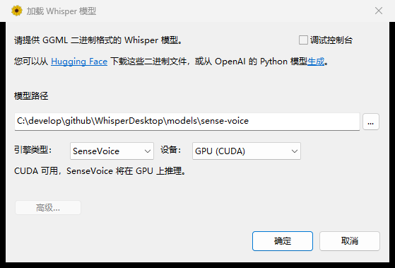
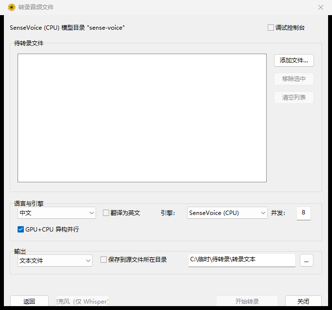
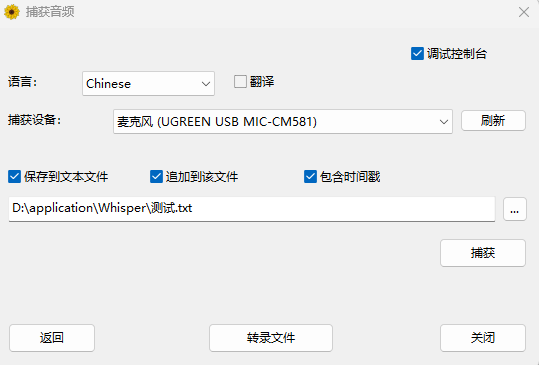
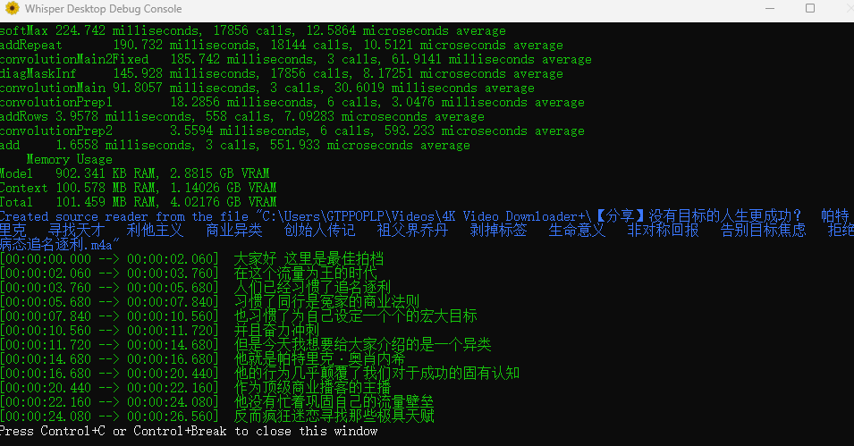

# WhisperDesktop（Windows）

WhisperDesktop 是一个运行在 **Windows 64 位**上的本地语音转文字工具，  
基于 OpenAI Whisper 模型的 C/C++ 实现，可将音频、视频或麦克风输入转录为文本。

本项目适合：
- 会议/访谈录音整理
- 课程、播客、视频的文字转写
- 本地、离线的批量语音转录需求

---

## 快速开始

1. 在 **Releases** 页面下载 WhisperDesktop
2. 解压后运行 `WhisperDesktop.exe`
3. 首次使用请先下载并加载模型（推荐 `ggml-medium.bin`）

---

## 源码运行说明

如果是从源码运行，而不是直接使用 `Releases` 中的程序，建议按下面顺序操作。

### 1. 使用 Visual Studio 打开并生成

1. 使用 Visual Studio 打开解决方案
2. 选择 `x64` 平台与 `Debug` 或 `Release` 配置
3. **先生成 `ComputeShaders` 项目**，再生成整个解决方案

> `ComputeShaders` 会生成 `Whisper\D3D\shaderData-Debug.inl` / `shaderData-Release.inl`。  
> 如果出现 `E1696: 无法打开源文件 "shaderData-Debug.inl"`，通常就是这个生成步骤还没执行。
>
> `Release` 配置还需要 `Tools\CompressShaders` 在 Release 下运行一次（它读取
> `ComputeShaders\x64\Release\*.cso`，生成 `shaderData-Release.inl`）。该工具是 .NET 项目，
> 需要本机装有 .NET SDK 才能 `dotnet build`。

> 如果本机没有 `v145` 平台工具集，可以在命令行指定已安装的工具集，例如：
>
> ```powershell
> msbuild Examples\WhisperDesktop\WhisperDesktop.vcxproj -p:Configuration=Debug -p:Platform=x64 -p:PlatformToolset=v143 -p:SolutionDir="%CD%\"
> ```

### 2. 准备推理运行库（Whisper / SenseVoice）

Whisper 与 SenseVoice 两种引擎的运行库都不入库，需要本地拉取：

```powershell
# Whisper（ggml）：由解决方案中的 Whisper 项目生成 Whisper.dll

# 下面两种包二选一，它们都解压到同一个 lib\ 目录

# SenseVoice CPU 版（约 22MB）
.\third_party\sherpa-onnx\fetch.ps1

# SenseVoice CUDA/GPU 版（约 460MB，含 onnxruntime_providers_cuda.dll）
# CUDA 包里同样包含 CPU 所需的 DLL，装了它就不必再拉 CPU 版
.\third_party\sherpa-onnx\fetch.ps1 -Cuda
```

生成的 DLL 会由项目的 PostBuild 事件自动复制到输出目录（`x64\Debug` 或 `x64\Release`）；
当 `lib\` 里存在 `onnxruntime_providers_cuda.dll` 时，会连同 CUDA 相关 DLL 一起复制。

### 3. 运行桌面程序

将 `Examples\WhisperDesktop\WhisperDesktop.vcxproj` 设为启动项目后直接运行即可。

首次运行时需要准备模型文件：

**Whisper（ggml 格式）**，例如：

- `models\ggml-medium.bin`
- `models\ggml-small.bin`

**SenseVoice**，放在 `models\sense-voice\`（也可在界面上选任意目录）：

- `model.int8.onnx`（或 `model.onnx`）
- `tokens.txt`

也可用环境变量 `WHISPERDESKTOP_SENSEVOICE_MODEL` 指向模型目录。

### 4. 命令行运行 .NET 示例

仓库中还包含基于 `WhisperNet` 的 .NET 6 示例。下面是常见运行方式。

#### 转录音频文件

```powershell
dotnet run --project Examples\TranscribeCS\TranscribeCS.csproj -c Debug -p:Platform=x64 -- -m models\ggml-medium.bin -l zh -otxt .\sample.wav
```

说明：

- `-m`：指定模型文件
- `-l zh`：指定语言为中文
- `-otxt`：同时输出 `.txt` 文本结果

#### 列出麦克风设备

```powershell
dotnet run --project Examples\MicrophoneCS\MicrophoneCS.csproj -c Debug -p:Platform=x64 -- -ld
```

#### 使用指定麦克风实时转录

```powershell
dotnet run --project Examples\MicrophoneCS\MicrophoneCS.csproj -c Debug -p:Platform=x64 -- -m models\ggml-medium.bin -l zh -c 0
```

说明：

- `-c 0`：使用编号为 `0` 的录音设备
- 可先通过 `-ld` 查看设备列表

### 5. 运行前的注意事项

- 请确保输出目录中存在 `Whisper.dll`
- 请确保模型文件路径正确
- .NET 示例默认目标为 `net6.0-windows`，需要本机安装对应 .NET 运行时

---

## SenseVoice 引擎

除 Whisper 之外，程序内置了 [sherpa-onnx](https://github.com/k2-fsa/sherpa-onnx) 驱动的 SenseVoice 引擎：
模型体积小、CPU 上速度很快，原生支持中 / 英 / 日 / 韩 / 粤。

### 在界面上选择引擎

「加载 Whisper 模型」界面底部有三个下拉框：

| 控件 | 说明 |
| --- | --- |
| **引擎类型** | `Whisper` / `SenseVoice` |
| **模型实现** | 仅 Whisper 有效，即上游的 CUDA / Direct3D 等实现 |
| **设备** | 仅 SenseVoice 有效，可选 `CPU` 或 `GPU (CUDA)`；CUDA 不可用时显示为 `GPU (CUDA，不可用)`，下方小字写明缺哪个 DLL |

操作步骤：

1. 点「返回」进入 **加载 Whisper 模型** 界面
2. 在「引擎类型」里选择 **SenseVoice**
3. 此时会多出 **设备** 下拉框，可选 `CPU` 或 `GPU (CUDA)`
4. 路径框填 SenseVoice 模型目录，点「确定」



选择结果会记在注册表里（`HKCU\SOFTWARE\const.me\WhisperDesktop`）：

| 值 | 含义 |
| --- | --- |
| `engine` | `whisper-gpu` / `sherpa-sensevoice` / `sherpa-sensevoice-gpu` |
| `modelPath` | Whisper 的 ggml 模型路径 |
| `modelImpl` | Whisper 的实现选择 |
| `senseVoiceDir` | SenseVoice 模型目录 |
| `senseVoiceDevice` | `cpu` 或 `gpu` |

转写界面的「引擎」下拉框默认跟随这里的选择，也会记住上次手动切换的结果。

### GPU（CUDA）需要的条件

SenseVoice 的 GPU 推理走 ONNX Runtime 的 CUDA Execution Provider，需要：

| 组件 | 说明 |
| --- | --- |
| NVIDIA 显卡 + 驱动 | 需支持 CUDA 13.x |
| CUDA 13 Toolkit | 提供 `cudart64_13.dll` / `cublas64_13.dll` / `cublasLt64_13.dll` |
| cuDNN 9 | 提供 `cudnn64_9.dll` 等 |
| CUDA 版 sherpa-onnx | `fetch.ps1 -Cuda`，含 `onnxruntime_providers_cuda.dll` |

最省事的装法：

```powershell
# 1) CUDA Toolkit 从 NVIDIA 官网安装（安装后会自动设置 CUDA_PATH）

# 2) cuDNN 9 可以直接从 pip 包里取 DLL，无需安装器
pip download nvidia-cudnn-cu13 --no-deps -d %TEMP%\cudnn-dl
# 解压 whl，把 nvidia\cudnn\bin\*.dll 拷到输出目录（与 WhisperDesktop.exe 同目录）

# 3) CUDA 版 sherpa 运行库
.\third_party\sherpa-onnx\fetch.ps1 -Cuda -Force
```

### 程序做了什么兜底

CUDA 环境在 Windows 上很容易「看起来装了但跑不起来」，程序为此做了几件事：

- **自动定位 `onnxruntime.dll`**：`C:\Windows\System32\onnxruntime.dll` 是系统自带的旧版本（1.17），
  会被优先加载，导致 CUDA 版 sherpa 报 `requested API version [28] is not available`。
  程序启动时会先用绝对路径把 exe 同目录的 `onnxruntime.dll` 钉死。
- **自动补齐 CUDA 路径**：从 IDE / 终端启动时进程 PATH 可能没有 CUDA 的 `bin`，
  程序会读取 `CUDA_PATH` 把 `bin`、`bin\x64` 追加进本进程 PATH。
- **真实推理探测**：创建出 CUDA 识别器后，会先跑一小段静音确认结果真的能返回。
  （sherpa 在 CUDA provider 注册失败时仍会返回非空识别器，随后静默用 CPU，只靠返回值判断会误报。）
- **缺失时明确提示**：设备下拉框会显示 `GPU (CUDA，不可用)`，并在下方小字里写明缺哪个 DLL。
- **自动回退**：GPU 不可用时引擎会回退到 CPU 继续工作，不会让整批任务失败。

### 注意事项

- 模型下载：推荐使用 `model.int8.onnx`（约 230MB）与 `tokens.txt`，通常从 HuggingFace 上的
  SenseVoiceSmall 仓库获取；也可以换成 `model.onnx`（fp32，体积更大）。
- 同一时间建议只用一张卡跑 SenseVoice；GPU 模式下程序会按显存限制并发数。
- 多卡机器目前只会使用可用显存最大的那块卡，没有做跨卡分流。
- SenseVoice 的语言下拉框只认 自动 / 中文 / 英语 / 日语 / 韩语 / 粤语，其它语言会自动按「自动」处理。

---

## 批量转写：引擎与并发调度

“转录文件”界面按操作顺序分成四块：**待转录文件 → 语言与引擎 → 输出 → 操作按钮**。

| 控件 | 位置 | 说明 |
| --- | --- | --- |
| **添加文件… / 移除选中 / 清空列表** | 文件列表右侧 | 列表支持多选（Ctrl / Shift） |
| **语言** | 语言与引擎 | 识别语言，另有“翻译为英文”勾选框 |
| **引擎** | 语言与引擎 | `Whisper (GPU)` / `SenseVoice (CPU)` / `SenseVoice (GPU)`；默认跟随“加载模型”界面的选择 |
| **并发** | 语言与引擎 | 同时处理几个文件。留空或填 `0` 表示自动，按硬件推算；点击“开始转录”后输入框会回填实际使用的值 |
| **GPU+CPU** | 语言与引擎 | 异构并行开关。引擎列表里同时存在 GPU 条目和 CPU 条目时可用，否则置灰 |
| **输出格式 / 保存到源文件所在目录 / 输出文件夹** | 输出 | 格式选“不输出”时整区置灰；勾选“保存到源文件所在目录”时输出文件夹置灰 |
| **开始转录** | 底部右侧 | 列表为空时置灰；转录中变为“停止转录” |

转录过程中，文件列表会实时显示每个文件的状态（待办的 / 执行中 / 完成 / 失败）、
进度百分比和已用时间，底部进度条显示运行中任务的平均进度。

### 并发数是怎么算出来的

自动模式下按引擎类型分别推算，取各项上限中的最小值：

| 引擎 | 推荐并发 |
| --- | --- |
| SenseVoice CPU | `min(逻辑核 × 2/3, 可用内存扣 1.5GB 后 × 70% ÷ 单实例内存)` |
| SenseVoice GPU | `min(逻辑核 × 2/3, (可用显存 − 512MB) × 70% ÷ 单实例显存)` |
| Whisper (GPU) | 固定 `1`（不申报单实例显存占用，保守处理） |

几点说明：

- 显存取的是 DXGI 报告的「本进程可用显存预算」，已经扣掉其它程序占用的部分
- 并发数不会超过待办文件数，避免多出来的线程白加载一遍模型
- 手填的并发数也会被上面的硬件上限截断，超出时会记一条警告日志
- GPU 模式多用显存不会像内存那样借用回系统内存，超出会掉到内存、性能断崖式下跌，
  所以留了 30% 余量

### GPU+CPU 异构并行

勾选后，GPU 槽和 CPU 槽共享同一个任务队列，谁空闲谁取下一个文件：

- **CPU 槽数量**：用输入框里填的值，没填就按 CPU 引擎的推荐值
- **GPU 槽数量**：按显存推算，输入框里的值**不影响** GPU 槽
- 槽位总数同样不超过待办文件数，且 CPU 槽排在前面
  → 文件数较少时会优先分配到 CPU 槽（SenseVoice 是非自回归模型，单文件速度很快）
- 选中的是 CPU 变体、但同类实现还有 GPU 变体时，同样能组成异构
- 选中的是 GPU 变体时，会优先用同一实现的 CPU 变体配对（例如
  `SenseVoice (GPU)` + `SenseVoice (CPU)`），两边的速度和文本风格更一致
- Whisper 只有 GPU 条目、没有 CPU 变体，所以单独用 Whisper 时这个开关不可用

这些选项（引擎、并发数、异构并行）会记在注册表里，下次打开自动恢复。

---

## 界面与功能概览

### 加载模型
下载并选择 Whisper 模型文件（模型越大，效果通常越好）


---

### 转录文件
批量转录本地音频或视频文件，适合整理录音资料。
可选识别引擎、设置并发数，或勾选「GPU+CPU」让显卡和处理器同时干活。



---

### 捕获音频
从麦克风实时捕获并转录语音，适合会议或即时记录



---

### 调试控制台
提供中文 UI 与控制台输出，便于查看运行状态与日志



---

## 主要特性

- 基于 Whisper 模型的本地语音识别
- 支持批量文件转录与实时麦克风转录
- **内置 SenseVoice 引擎**：支持中 / 英 / 日 / 韩 / 粤，可在界面上切换 **CPU / GPU (CUDA)**
- **批量转写多引擎调度**：可选引擎、按 CPU / 显存自动推算并发数，支持 GPU+CPU 异构并行
- Windows 原生实现：基于 MSVC 开发，无需 Python 或额外运行时
- 支持 GPU 加速（Direct3D 11）：适配 RTX 3070 Ti 等主流显卡
- SenseVoice 支持 CUDA 加速（ONNX Runtime CUDA EP），不可用时自动回退 CPU
- 新增 Whisper V3 Turbo 模型支持：兼顾识别速度与准确率
- 深度支持中文与粤语：优化多语言代码映射，提供原生粤语选项
- 中文界面与调试优化：支持控制台日志路径自定义，适合日常及工程使用

---

## 系统要求

- **操作系统**：Windows 64 位（推荐 Windows 10 / 11）
- **显卡**：支持 Direct3D 11 的 GPU（Whisper）
- **显卡**：NVIDIA + CUDA 13.x + cuDNN 9（SenseVoice GPU 模式，可选）
- **CPU**：支持 AVX / F16C 指令集

---

## 二次开发与改动说明

本项目基于上游 Whisper Windows 实现进行整理与二次开发，主要包括：

- 界面与交互优化，简化使用流程
- 中文界面与提示信息（部分由 AI 辅助翻译并调整）
- 使用体验与稳定性改进
- 功能取舍与精简，面向日常使用场景
- **新增 SenseVoice 引擎**（sherpa-onnx）：中 / 英 / 日 / 韩 / 粤，可在界面切换 CPU / GPU
- 引擎抽象层（`Examples\WhisperDesktop\Asr\`）：统一 Whisper 与 SenseVoice 的加载与并发调度
- 批量转写调度器：按引擎能力（`sAsrEngineInfo`）自动推算并发、支持 GPU / CPU 异构槽位共享队列

> 本仓库更侧重“拿来即用”，而非底层实现细节。

---

## 免责声明

本软件按“现状（AS IS）”提供，不对识别准确率或使用结果作任何保证。  
语音识别效果会受到音质、口音、噪声、模型大小等因素影响。

---

## 上游项目与致谢

- Whisper Windows 实现（Const-me）  
  https://github.com/Const-me/Whisper
- whisper.cpp（C/C++ 实现）  
  https://github.com/ggerganov/whisper.cpp
- OpenAI Whisper 模型  
  https://github.com/openai/whisper
- sherpa-onnx（SenseVoice 推理）  
  https://github.com/k2-fsa/sherpa-onnx
- SenseVoice 模型（FunAudioLLM）  
  https://github.com/FunAudioLLM/SenseVoice

---

## License

本项目遵循上游项目的开源许可证要求，  
具体请查看仓库中的 `LICENSE` 文件。
